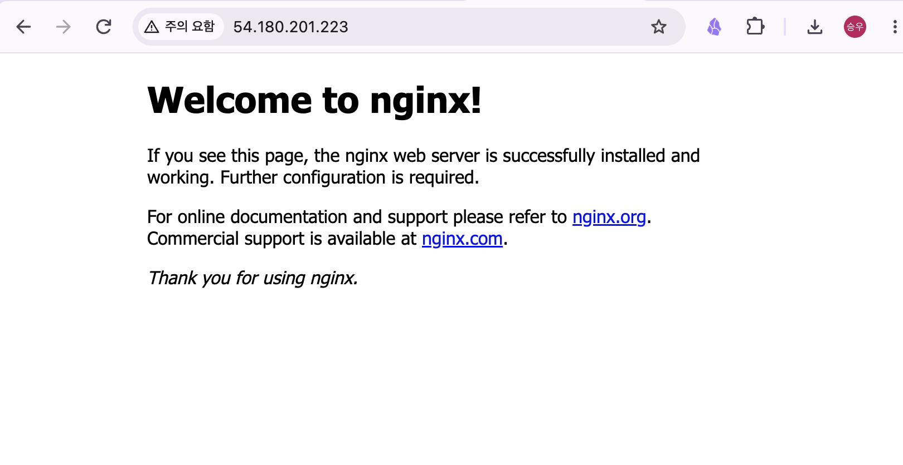

# vpc-web

웹 서비스 인프라를 직접 구축하며 안정적인 서비스 환경을 설계 및 구현합니다.

AWS 서울 리전(`ap-northeast-2`)에 VPC → 퍼블릭 서브넷 → 인터넷 게이트웨이 → EC2(Nginx)를 직접 구성해, 외부에서 웹 서비스에 접속할 수 있게 만드는 미션입니다.

## 외부 접속 검증

- 선택한 방식: **(A) 브라우저로 `http://<퍼블릭IP>` 접속** (B `/health`는 선택으로 추가 예정)
- 접속 정보: `http://54.180.201.223` (EC2 퍼블릭 IPv4 자동 할당, 2026-11-18. 인스턴스를 중지·재시작하면 바뀜)
- 결과: 2026-11-18 17:45 KST, 외부 브라우저에서 Nginx 기본 페이지 확인

### 단계별 증빙

| 순서 | 무엇을 확인했나 | 스크린샷 |
|---|---|---|
| 1 | 보안그룹 인바운드: 80/TCP `0.0.0.0/0`, 22/TCP 내 IP `/32` 두 줄만 | [01](docs/images/01-sg-inbound-rules.png) |
| 2 | EC2 실행 중, 퍼블릭 IPv4 할당됨 | [02](docs/images/02-ec2-running-public-ip.png) |
| 3 | 노트북 → EC2 SSH 접속 성공 (`ubuntu@ip-10-0-1-7`) | [03](docs/images/03-ssh-connected.png) |
| 4 | EC2 → 인터넷 요청 성공 (`curl -I https://example.com` → 200) | [04](docs/images/04-ec2-curl-example-com.png) |
| 5 | EC2 안에서 Nginx 응답 (`curl -I http://localhost` → 200, `Server: nginx`) | [05](docs/images/05-nginx-localhost.png) |
| 6 | 외부 브라우저에서 Nginx 페이지 | [06](docs/images/06-browser-welcome-nginx.png) |

## 아키텍처

- 다이어그램: [`docs/architecture.png`](docs/architecture.png) ← ①-3에서 초안

## 계정과 권한

- 실습은 IAM 사용자 `mission-user`로만 한다. 처음에는 `AmazonEC2FullAccess`를 붙였다가, 2026-11-18에 실제로 한 작업과 앞으로 할 정리 작업만 적은 고객 관리형 정책 [`vpc-web-mission-policy`](docs/iam-policy.json)으로 바꾸고 FullAccess는 뗐다.
  - 허용: EC2 조회(`ec2:Describe*`), VPC·서브넷·IGW·라우팅 테이블·보안그룹·키 페어·인스턴스의 만들기·붙이기·지우기
  - 적지 않은 것(S3, RDS, IAM, 결제 등)은 자동으로 거부된다. 확인: VPC·인스턴스 목록은 보이고([08](docs/images/08-iam-check-vpc-list.png), [09](docs/images/09-iam-check-instance-list.png)), S3 버킷 만들기는 `s3:CreateBucket` 권한 없음으로 실패([10](docs/images/10-iam-check-s3-denied.png))
  - 붙은 정책 화면: [07](docs/images/07-iam-policy-attached.png)
- 루트 사용자는 MFA(패스키)를 걸고, IAM 사용자·정책 관리와 결제 확인 같은 **계정 관리에만** 쓴다.

## 만든 리소스 기록표

만드는 순간 한 줄씩 적는다. 실습이 끝나면 이 표를 보고 빠짐없이 지운 뒤 [`docs/cleanup-checklist.md`](docs/cleanup-checklist.md)에 근거를 남긴다.

| 만든 날 | 종류 | 이름 | 리전 | 어디에 붙었나 | 돈 나감? | 지운 날·근거 |
|---|---|---|---|---|---|---|
| 2026-11-17 | AWS 계정 | vpc-web-study | — | — | — | (유지) |
| 2026-11-17 | 루트 MFA | 패스키 | — | 루트 | 아니오 | — |
| 2026-11-17 | IAM 사용자 | mission-user (+ AmazonEC2FullAccess) | 전역 | — | 아니오 | |
| 2026-11-17 | VPC | vpc-web (10.0.0.0/16) | 서울 | — | 아니오 | |
| 2026-11-17 | 서브넷 | vpc-web-public (10.0.1.0/24, ap-northeast-2a) | 서울 | vpc-web | 아니오 | |
| 2026-11-17 | 인터넷 게이트웨이 | vpc-web-igw | 서울 | vpc-web (Attached) | 아니오 | |
| 2026-11-17 | 라우팅 테이블 | vpc-web-public-rt (0.0.0.0/0 → igw, 11-17 저장 누락 → 11-18 17:35 다시 추가) | 서울 | vpc-web, 서브넷 vpc-web-public에 연결 | 아니오 | |
| 2026-11-18 | 보안그룹 | vpc-web-sg (인바운드 80/TCP 0.0.0.0/0, 22/TCP 내 IP/32 · 아웃바운드 기본 전체) | 서울 | vpc-web (EC2에 붙일 예정) | 아니오 | |
| 2026-11-18 17:26 | 키 페어 | vpc-web-key (.pem은 노트북 ~/.ssh에만, 리포·드라이브에 두지 않음) | 서울 | vpc-web-server | 아니오 | |
| 2026-11-18 17:26 | EC2 인스턴스 | vpc-web-server (t3.micro, Ubuntu 24.04) | 서울 | 서브넷 vpc-web-public, 보안그룹 vpc-web-sg | 예 (실행 중일 때) | |
| 2026-11-18 17:26 | EBS 볼륨 | 8 GiB 루트 디스크 (인스턴스와 함께 생김) | 서울 | vpc-web-server | 예 (있는 동안, 중지해도) | |
| 2026-11-18 17:26 | 퍼블릭 IPv4 | 자동 할당 54.180.201.223 (중지하면 반납, 다시 시작하면 바뀜 → README 접속 주소 고치기) | 서울 | vpc-web-server | 예 (붙어 있는 동안) | |

## 크레딧 기록

| 날짜 | 남은 크레딧 | 사용 | 메모 |
|---|---|---|---|
| 2026-11-17 | US$100.00 | US$0.00 | 시작 기준값. 금액은 약 24시간마다 갱신됨 |

## 문서

- 트러블슈팅 보고서: [`docs/troubleshooting.md`](docs/troubleshooting.md)
- 리소스 정리 체크리스트: [`docs/cleanup-checklist.md`](docs/cleanup-checklist.md)

> 공개 리포에 올릴 때는 스크린샷 속 12자리 계정 ID를 가린다.
