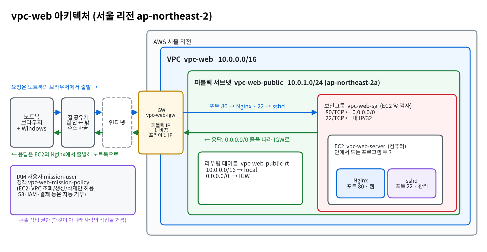

# vpc-web

웹 서비스 인프라를 직접 구축하며 안정적인 서비스 환경을 설계 및 구현합니다.

AWS 서울 리전(`ap-northeast-2`)에 VPC → 퍼블릭 서브넷 → 인터넷 게이트웨이 → EC2(Nginx)를 직접 구성해, 외부에서 웹 서비스에 접속할 수 있게 만드는 미션입니다.

## 외부 접속 검증

- 선택한 방식: **(A) 브라우저로 `http://<퍼블릭IP>` 접속**
- 접속 정보: `http://43.200.2.228` (EC2 퍼블릭 IPv4 자동 할당. 11-18에는 54.180.201.223이었고, 11-18 중지 후 11-19 16:45 다시 시작하며 바뀜 → [12](docs/images/12-ec2-restarted-new-ip.png))
- 결과: 2026-11-18 17:45 KST, 외부 브라우저에서 Nginx 기본 페이지 확인

### 단계별 증빙

| 순서 | 무엇을 확인했나 | 스크린샷 |
|---|---|---|
| 1 | 보안그룹 인바운드: 80/TCP `0.0.0.0/0`, 22/TCP 내 IP `/32` 두 줄만 | [01](docs/images/01-sg-inbound-rules.png) |
| 2 | EC2 실행 중, 퍼블릭 IPv4 할당됨 | [02](docs/images/02-ec2-running-public-ip.png) |
| 3 | 노트북 → EC2 SSH 접속 성공 (`ubuntu@ip-10-0-1-7`) | [03](docs/images/03-ssh-connected.png) |
| 4 | EC2 → 인터넷 요청 성공 (`curl -I https://example.com` → 200) | [04](docs/images/04-ec2-curl-example-com.png) |
| 5 | EC2 안에서 Nginx 응답 (`curl -I http://localhost` → 200, `Server: nginx`) | [05](docs/images/05-nginx-localhost.png) |
| 6 | 외부 브라우저에서 Nginx 페이지 | [06](docs/images/06-browser-welcome-nginx.png) |

## 아키텍처

## 요청과 응답 흐름

브라우저에서 `http://<퍼블릭IP>`를 열 때 패킷이 지나는 길이다. 상자를 눌러 단계별로 따라가고, 한 칸씩 빼 보며 어디서 멈추는지 확인하는 인터랙티브 버전: https://claude.ai/artifact/E9CAXCq93XWQSAXcmoSjBp

패킷 겉면에는 **받는 주소, 포트, 보낸 주소**가 적혀 있다. 지나가는 곳마다 보는 칸이 다르다.

**① 요청: "페이지 주세요"**

| 단계 | 지점 | 일어나는 일 |
|---|---|---|
| 1 | 브라우저 | 주소창에 EC2의 퍼블릭 IP를 치면 요청 패킷을 만든다. 받는 주소 = 퍼블릭 IP, 포트 = 80 (`http://`) |
| 2 | 인터넷 | 받는 주소를 따라 AWS 서울로 보낸다 |
| 3 | IGW | VPC 입구. 받는 주소를 퍼블릭 IP에서 EC2의 프라이빗 IP(10.0.1.7)로 바꿔 서브넷 안으로 넘긴다. 검사는 하지 않는다 |
| 4 | 보안그룹 | 포트(80)와 보낸 주소를 보고, 80번 줄(소스 `0.0.0.0/0`)과 맞아서 들여보낸다 |
| 5 | Nginx | EC2 안에서 80번으로 기다리던 Nginx가 받고 페이지를 준비한다 |

**② 응답: "여기 페이지"**

| 단계 | 지점 | 일어나는 일 |
|---|---|---|
| 6 | Nginx | 응답 패킷을 만든다. 받는 주소 = 내 노트북 |
| 7 | 라우팅 테이블 | 받는 주소가 VPC 밖이라 `0.0.0.0/0 → IGW` 줄을 따른다. 포트는 보지 않는다. (VPC 안 주소였다면 `10.0.0.0/16 → local`) |
| 8 | IGW | 보낸 주소를 프라이빗 IP에서 퍼블릭 IP로 바꿔 인터넷으로 내보낸다 |
| 9 | 인터넷 | 내 노트북으로 돌려보낸다 |
| 10 | 브라우저 | 페이지가 뜬다 |

**한 칸이 빠지면 어디서 멈추나**

| 빠진 것 | 어디서 막히나 | 보이는 증상 | 실제로 겪은 날 |
|---|---|---|---|
| EC2 퍼블릭 IP | 출발 전 (브라우저에 칠 주소가 없음) | 접속할 수 없음 | — |
| 보안그룹 80번 줄 | 보안그룹 (요청이 들어오다 버려짐) | 브라우저만 시간 초과 (SSH는 됨) | 11/19 실험 |
| 라우팅 `0.0.0.0/0 → IGW` 줄 | 라우팅 테이블 (응답이 나갈 길이 없음) | 브라우저·SSH **모두** 시간 초과 | 11/18 (저장 누락) |
| Nginx | EC2 안 (80번에서 받을 프로그램이 없음) | **즉시** 연결 거부 | 11/18 설치 전 |

- 라우팅 테이블은 **받는 주소**만, 보안그룹은 **포트와 보낸 주소**를 본다. 그래서 라우팅 줄이 빠지면 모든 포트가, 보안그룹 줄이 빠지면 그 포트만 막힌다.
- 같은 EC2에 웹(80)은 Nginx가, SSH(22)는 sshd가 받는다. IP는 컴퓨터를 찾고, 포트는 그 안의 프로그램을 찾는다.
- Nginx는 설치하면 기본 설정(`/etc/nginx/sites-enabled/default`의 `listen 80`)으로 80번에서 기다린다. 보안그룹 80번 줄은 이 포트에 맞춰 열었다.
- IAM은 패킷이 아니라 AWS 콘솔에서 하는 사람의 작업을 거른다. (그림 왼쪽 아래)

더 자세히: 집 공유기와 Windows까지 포함한 단계

집 공유기는 IGW와 같은 일을 한다. 집 안 주소(192.168.…)와 집 인터넷 주소를 바꾼다. 패킷 겉면 칸이 바뀌고 읽히는 모습을 따라가는 인터랙티브 버전: https://claude.ai/artifact/6D2QMqAfSYa9BRmFdRftFv

**요청**

| # | 지점 | 하는 일 | 겉면에서 |
|---|---|---|---|
| 1 | 브라우저 | 안쪽 글(`GET / HTTP/1.1`)을 쓰고, 주소창에서 받는 주소(퍼블릭 IP)와 포트(`http://` → 80)를 정함 | 받는 주소·포트 정함 |
| 2 | Windows | 글에 겉면을 붙여 패킷을 만들고, 보낸 주소(노트북의 집 안 주소)와 답장 받을 번호를 적음 | 보낸 주소 적음 |
| 3 | 집 공유기 | 보낸 주소를 집 안 주소에서 집 인터넷 주소로 바꿈 | 보낸 주소 바뀜 |
| 4 | 인터넷 | 받는 주소를 보고 AWS 서울로 배달 | 받는 주소 읽음 |
| 5 | IGW | 받는 주소를 퍼블릭 IP에서 EC2 프라이빗 IP(10.0.1.7)로 바꿔 서브넷 안으로 넘김. 검사는 하지 않음 | 받는 주소 바뀜 |
| 6 | 보안그룹 | 80번 줄(소스 `0.0.0.0/0`)과 맞는지 보고 통과. 맞는 줄이 없으면 대답 없이 버림 → 시간 초과 | 포트·보낸 주소 읽음 |
| 7 | Nginx | 80번에서 기다리던 Nginx가 받음. 22번이면 sshd가 받음. 기다리는 프로그램이 없으면 즉시 거부 | 포트 읽음 |

**응답**

| # | 지점 | 하는 일 | 겉면에서 |
|---|---|---|---|
| 1 | Nginx | 페이지를 담은 응답을 쓰고, 요청의 겉면을 뒤집어 붙임 (받는 주소 = 집 인터넷 주소, 보낸 주소 = 10.0.1.7) | 겉면 새로 씀 |
| 2 | 보안그룹 | 들여보낸 요청의 응답이라 다시 검사하지 않고 내보냄 | — |
| 3 | 라우팅 테이블 | 받는 주소가 VPC 밖이라 `0.0.0.0/0 → IGW` 줄로 보냄. 포트는 보지 않음 (11/18 이 줄이 없어서 전부 시간 초과) | 받는 주소 읽음 |
| 4 | IGW | 보낸 주소를 10.0.1.7에서 퍼블릭 IP로 바꿔 인터넷으로 | 보낸 주소 바뀜 |
| 5 | 인터넷 | 집 인터넷 주소로 배달 | 받는 주소 읽음 |
| 6 | 집 공유기 | 받는 주소를 노트북의 집 안 주소로 되돌림 | 받는 주소 바뀜 |
| 7 | Windows | 받는 포트(답장 번호)를 보고 브라우저에 안쪽 글만 건넴 | 포트 읽음 |
| 8 | 브라우저 | Welcome to nginx 화면을 그림 | — |

## 계정과 권한

- 실습은 IAM 사용자 `mission-user`로만 한다. 처음에는 `AmazonEC2FullAccess`를 붙였다가, 2026-11-18에 실제로 한 작업과 앞으로 할 정리 작업만 적은 고객 관리형 정책 [`vpc-web-mission-policy`](docs/iam-policy.json)으로 바꾸고 FullAccess는 뗐다.
  - 허용: EC2 조회(`ec2:Describe*`), VPC·서브넷·IGW·라우팅 테이블·보안그룹·키 페어·인스턴스의 만들기·붙이기·지우기
  - 적지 않은 것(S3, RDS, IAM, 결제 등)은 자동으로 거부된다. 확인: VPC·인스턴스 목록은 보이고([08](docs/images/08-iam-check-vpc-list.png), [09](docs/images/09-iam-check-instance-list.png)), S3 버킷 만들기는 `s3:CreateBucket` 권한 없음으로 실패([10](docs/images/10-iam-check-s3-denied.png))
  - 붙은 정책 화면: [07](docs/images/07-iam-policy-attached.png)
- 루트 사용자는 MFA(패스키)를 걸고, IAM 사용자·정책 관리와 결제 확인 같은 **계정 관리에만** 쓴다.

## 정리

2026-11-20 22:08~22:16에 [체크리스트](docs/cleanup-checklist.md) 순서대로 모두 종료·삭제했다(EC2 → EBS 확인 → EIP 확인 → 보안그룹 → 서브넷 → 라우팅 테이블 → IGW 분리·삭제 → VPC). 남은 것은 계정에 원래 있던 기본 VPC뿐이다.

## 만든 리소스 기록표

만드는 순간 한 줄씩 적는다. 실습이 끝나면 이 표를 보고 빠짐없이 지운 뒤 [`docs/cleanup-checklist.md`](docs/cleanup-checklist.md)에 근거를 남긴다.

| 만든 날 | 종류 | 이름 | 리전 | 어디에 붙었나 | 돈 나감? | 지운 날·근거 |
|---|---|---|---|---|---|---|
| 2026-11-17 | AWS 계정 | vpc-web-study | — | — | — | (유지) |
| 2026-11-17 | 루트 MFA | 패스키 | — | 루트 | 아니오 | — |
| 2026-11-17 | IAM 사용자 | mission-user (+ AmazonEC2FullAccess) | 전역 | — | 아니오 | |
| 2026-11-17 | VPC | vpc-web (10.0.0.0/16) | 서울 | — | 아니오 | |
| 2026-11-17 | 서브넷 | vpc-web-public (10.0.1.0/24, ap-northeast-2a) | 서울 | vpc-web | 아니오 | |
| 2026-11-17 | 인터넷 게이트웨이 | vpc-web-igw | 서울 | vpc-web (Attached) | 아니오 | |
| 2026-11-17 | 라우팅 테이블 | vpc-web-public-rt (0.0.0.0/0 → igw, 11-17 저장 누락 → 11-18 17:35 다시 추가) | 서울 | vpc-web, 서브넷 vpc-web-public에 연결 | 아니오 | |
| 2026-11-18 | 보안그룹 | vpc-web-sg (인바운드 80/TCP 0.0.0.0/0, 22/TCP 내 IP/32 · 아웃바운드 기본 전체). **22번 소스 변경 기록**: 11-18 13:17 학습장 IP → 11-19 16:55 집 IP (장소를 옮기면 그때 IP로 바꾸고 여기에 적기) | 서울 | vpc-web (EC2에 붙일 예정) | 아니오 | |
| 2026-11-18 17:26 | 키 페어 | vpc-web-key (.pem은 노트북 ~/.ssh에만, 리포·드라이브에 두지 않음) | 서울 | vpc-web-server | 아니오 | |
| 2026-11-18 17:26 | EC2 인스턴스 | vpc-web-server (t3.micro, Ubuntu 24.04) — 11-18 18:23 중지(디스크는 남아 과금), 11-19 16:45 다시 시작, 17:44 다시 중지(실습 끝, 정리 때 종료 예정) | 서울 | 서브넷 vpc-web-public, 보안그룹 vpc-web-sg | 예 (실행 중일 때) | |
| 2026-11-18 17:26 | EBS 볼륨 | 8 GiB 루트 디스크 (인스턴스와 함께 생김) | 서울 | vpc-web-server | 예 (있는 동안, 중지해도) | |
| 2026-11-18 17:26 | 퍼블릭 IPv4 | 자동 할당 54.180.201.223 → 11-18 18:23 중지로 반납([11](docs/images/11-ec2-stopped-ip-released.png)). 11-19 16:45 다시 시작 → 새 주소 43.200.2.228 (프라이빗 10.0.1.7은 그대로) | 서울 | vpc-web-server | 예 (붙어 있는 동안) | |

## 크레딧 기록

| 날짜 | 남은 크레딧 | 사용 | 메모 |
|---|---|---|---|
| 2026-11-17 | US$100.00 | US$0.00 | 시작 기준값. 금액은 약 24시간마다 갱신됨 |
| 2026-11-21 | US$119.91 | 약 US$0.09 | 정리(11-20 22:16) 다음 날 확인. 무료 플랜 활동으로 받은 크레딧이 더해진 것으로 보임(100 + 20 − 0.09). 예상(EC2 약 2시간 + 디스크 며칠 ≈ 10센트 안쪽)과 일치. 무료 플랜이라 청구 금액 0원 — [화면](docs/images/billing-01-credits-1121.png) |

## 문서

- [아키텍처 그림](docs/architecture.png)
- [트러블슈팅](docs/troubleshooting.md) (원본 메모: [troubleshooting-notes.md](docs/troubleshooting-notes.md))
- [리소스 정리 체크리스트](docs/cleanup-checklist.md)
- [IAM 정책](docs/iam-policy.json)

> 공개 리포에 올릴 때는 스크린샷 속 12자리 계정 ID를 가린다.
